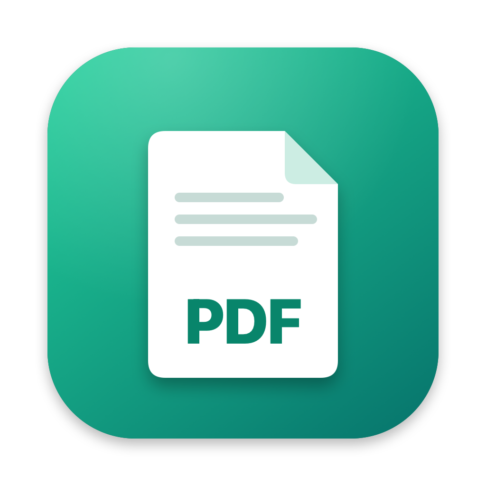
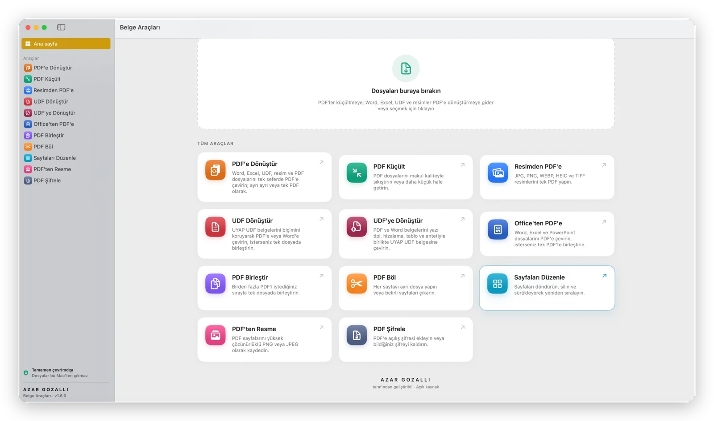
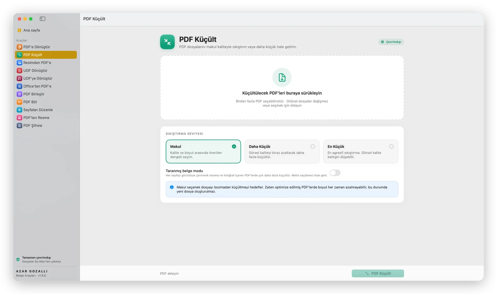
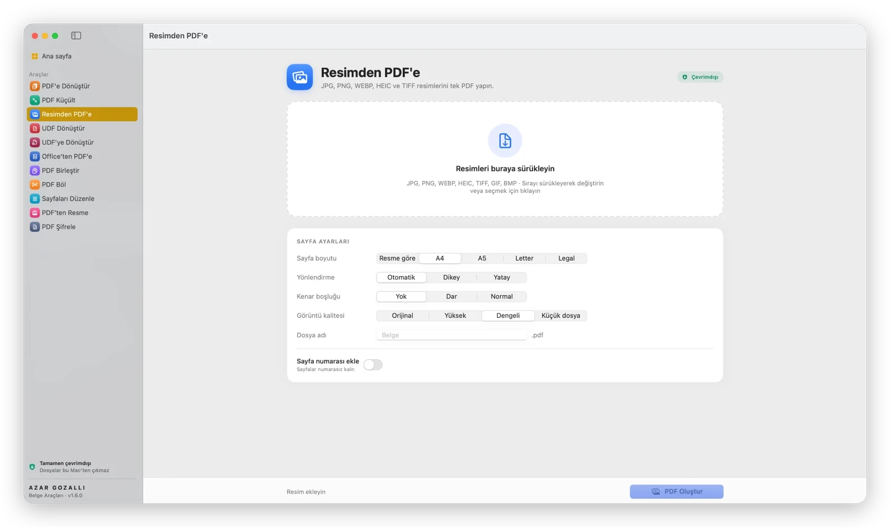
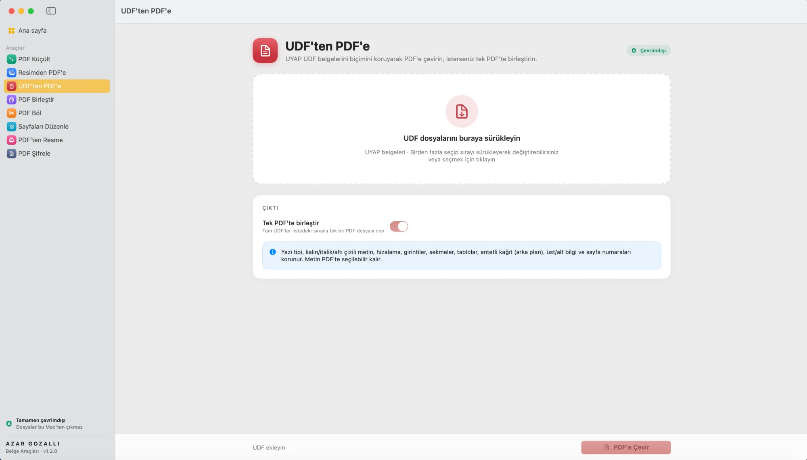
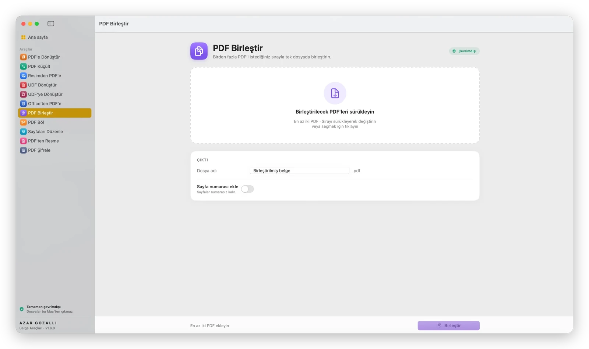
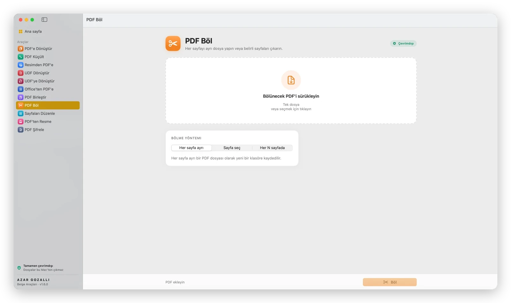
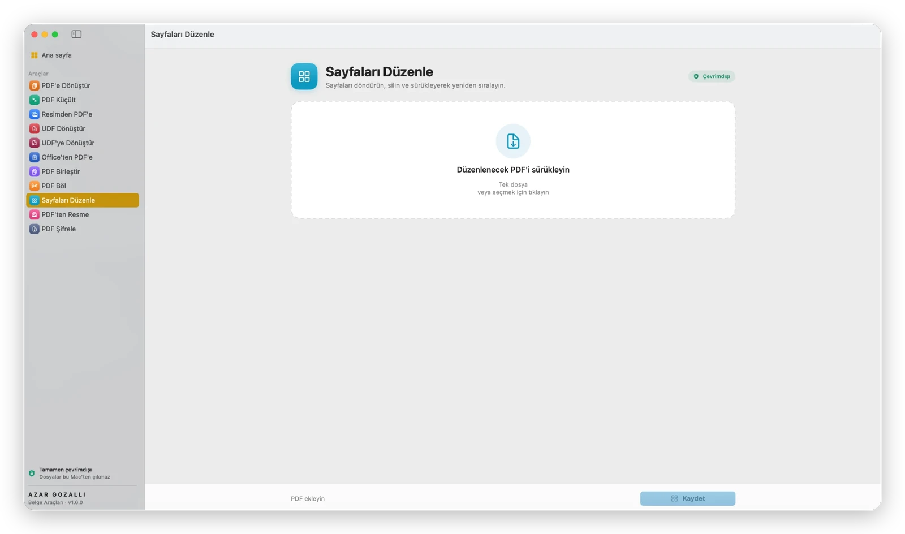
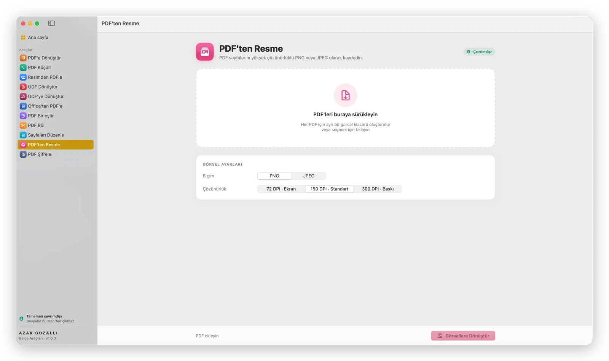
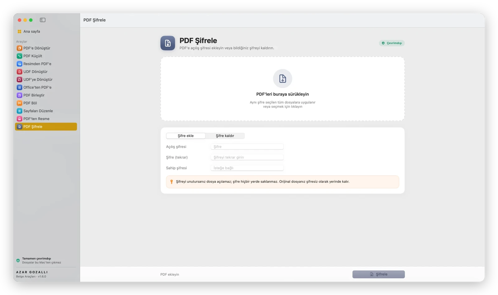

<p align="center">
  
</p>

<h1 align="center">Belge Araçları</h1>

<p align="center">
  <b>macOS</b> ve <b>Windows</b> için tamamen <b>çevrimdışı</b> çalışan, hafif ve açık kaynak PDF araç kutusu.<br>
  Dosyalarınız hiçbir zaman bilgisayarınızdan çıkmaz.
</p>

<p align="center"><b>Geliştiren: AZAR GOZALLI</b></p>

<p align="center">
  
</p>

---

## Ekran görüntüleri

| PDF Küçült | Resimden PDF'e |
|---|---|
|  |  |
| **UDF Dönüştür** | **PDF Birleştir** |
|  |  |
| **PDF Böl** | **Sayfaları Düzenle** |
|  |  |
| **PDF'ten Resme** | **PDF Şifrele** |
|  |  |

## Özellikler

| Araç | Ne yapar |
|---|---|
| **PDF'e Dönüştür** | Word, Excel, PowerPoint, UDF, resim (JPG, PNG, TIFF…) ve PDF dosyalarını **karışık olarak tek ekrana bırakın**; her birini ayrı PDF yapın veya listedeki sırayla **tek PDF'te birleştirin**. |
| **UDF'ye Dönüştür** | **PDF** ve **Word** (.docx, .doc, .rtf, .odt) belgelerini UYAP UDF'ye çevirir; yazı tipleri, boyutlar, kalın/italik/altı çizili, renkler, hizalama, girintiler, satır aralığı, sekmeler, listeler, tablolar, resimler, antet, üst/alt bilgi ve sayfa numaraları korunur. PDF'ler için "birebir görünüm" seçeneği her sayfayı resim olarak koyar. |
| **Office'ten PDF'e** | Word (.docx, .doc, .rtf, .odt), Excel (.xlsx, .xls, .ods, .csv) ve PowerPoint (.pptx, .ppt, .odp) dosyalarını PDF'e çevirir; isterseniz tek PDF'te birleştirir. |
| **PDF Küçült** | Makul / Daha Küçük / En Küçük seviyeleri. Metin seçilebilir kalır. Taranmış belgeler için ayrıca "taranmış belge modu". Birden fazla dosyayı tek seferde işler. |
| **UDF Dönüştür** | UYAP belgelerini (.udf) biçimini koruyarak **PDF'e veya Word'e (.docx)** çevirir. Birden fazla UDF'yi sürükleyerek sıralayıp tek PDF'te veya tek Word belgesinde birleştirebilirsiniz. Yazı tipi, kalın/italik/altı çizili, hizalama, girintiler, sekmeler, numaralı listeler, tablolar, resimler, antetli kağıt (arka plan), üst/alt bilgi ve sayfa numaraları korunur; metin seçilebilir kalır. |
| **Resimden PDF'e** | JPG, PNG, WEBP, HEIC, TIFF (çok sayfalı), GIF, BMP → tek PDF. Sayfa boyutu (A4, A5, Letter, Legal, resme göre), yönlendirme, kenar boşluğu ve kalite ayarı. Sürükleyerek sıralama. |
| **PDF Birleştir** | Birden fazla PDF'i istediğiniz sırayla tek dosyada birleştirir. |
| **PDF Böl** | Her sayfayı ayrı dosya yapar, `1-3, 5, 8-` gibi sayfaları çıkarır veya her N sayfada böler. |
| **Sayfaları Düzenle** | Sayfa küçük resimleri üzerinde döndürme, silme ve sürükleyerek sıralama. |
| **PDF'ten Resme** | Sayfaları 72 / 150 / 300 DPI PNG veya JPEG olarak kaydeder. |
| **PDF Şifrele** | Açılış şifresi ekler veya bildiğiniz şifreyi kaldırır. |

**Sayfa numarası ekle:** PDF üreten her araçta (PDF'e Dönüştür, Office'ten PDF'e, Resimden PDF'e, UDF Dönüştür, PDF Birleştir) çıkan PDF'in her sayfasına sırayla numara eklenebilir. Konum (sol/orta/sağ, üst/alt) ve biçim ("1", "1 / 12", "Sayfa 1", "Sayfa 1 / 12", "- 1 -") seçilir; birleştirilen PDF'te numaralar baştan sona kesintisiz devam eder, döndürülmüş sayfalarda da doğru köşeye düz yazılır. Orijinal PDF'ler hiçbir zaman değiştirilmez; numara yeni dosyaya eklenir.

- Giriş ekranı veya hesap yoktur; uygulama açılınca doğrudan çalışır.
- **Ağ kodu yoktur.** Hiçbir veri internete gönderilmez veya internetten alınmaz.
- Orijinal dosyalar hiçbir zaman değiştirilmez veya üzerine yazılmaz. Yeni dosyalar orijinalin yanına (veya Ayarlar'da seçtiğiniz klasöre) kaydedilir.
- PDF küçültme, sonuç orijinalden büyük çıkarsa yeni dosya oluşturmaz.
- Finder'da PDF veya resimleri Dock simgesinin üzerine bırakabilir veya "Birlikte Aç" menüsünden kullanabilirsiniz.
- Açık ve koyu görünüm desteklenir. Apple Silicon ve Intel Mac'lerde çalışır (macOS 14 Sonoma ve üzeri).
- **Windows 10 ve 11** için ayrı bir sürüm vardır (aşağıya bakın). Arayüz ve araçlar aynıdır. Tek fark: Windows sürümü HEIC fotoğrafları okumaz; önce JPG olarak kaydedin.

### UDF nasıl dönüştürülür?

UDF, UYAP Doküman Editörü'nün biçimidir: içinde tüm metin ve her metin parçasının yazı tipi, boyutu, hizalaması, girintileri ve sekme durakları bulunan bir XML dosyası taşıyan bir ZIP arşividir. Uygulama bu bilgileri okuyup sayfayı UYAP'ın kurallarıyla yeniden dizer:

- **macOS:** Apple'ın metin motoru (TextKit) ile doğrudan PDF'e çizilir.
- **Windows:** Belge HTML'e çevrilip yerleşik Microsoft Edge WebView2 motoruyla PDF'e yazdırılır; antet, üst/alt bilgi ve sayfa numaraları her sayfanın altına ayrı bir katman olarak yerleştirilir.

Satır kırılımları iki platformda ve UYAP'ta yazı tipi ölçümü farkından dolayı birkaç kelime kayabilir; içerik ve biçim aynı kalır.

Desteklenen UDF özellikleri: yazı tipi, boyut, kalın/italik/altı ve üstü çizili, yazı ve zemin rengi, hizalama, girintiler (asılı girinti dahil), satır aralığı, paragraf boşlukları, sekme durakları (sola/sağa/ortaya/ondalık hizalı; noktalı, tireli ve çizgili dolgular), çok düzeyli numaralı ve madde işaretli listeler (Türk alfabesiyle harfli, Roma rakamlı, `NumberSetted` ile devam eden), satır bazında birleştirilmiş hücreli ve iç içe tablolar ile kenarlık türleri, satır içi resimler, antetli kağıt, üst/alt bilgi ve sayfa numaraları.

#### UDF → Word

Word çıktısı düzenlenebilir bir `.docx` belgesidir ve Microsoft Word, Pages ve LibreOffice'te açılır. Sayfa boyutu ve kenar boşlukları, yazı tipleri, hizalama, girintiler, sekmeler ve dolguları, tablolar (birleştirilmiş hücreler dahil), resimler ve üst/alt bilgi korunur. Antet her sayfada metnin arkasında durur; sayfa numaraları Word'ün canlı alanlarıdır (SAYFA / TOPLAM). Birleştirilen her UDF, kendi sayfa düzeni ve numaralandırmasıyla ayrı bir Word bölümü olur.

Liste numaraları UYAP'taki gibi metin olarak yazılır: Word'ün harfli numaralandırması İngiliz alfabesini kullanır (a, b, c, d), UYAP ise Türk alfabesini (a, b, c, ç). Satır kırılımları Word'ün yazı ölçülerine göre biraz değişebilir.

Word yazıcısı her iki platformun ortak kullandığı Rust çekirdeğindedir (`core/`): Windows sürümü bunu doğrudan içerir, macOS sürümü ise uygulama paketinde `belge-core` adlı küçük bir komut satırı aracı olarak taşır.

**Teşekkür:** UYAP Doküman Editörü'nün bazı öznitelikleri nasıl yorumladığına dair bilgiler (sayfa numarası bitleri, alt düzey liste biçimleri, harfli listelerin Türk alfabesiyle sayılması, tablo sütun oranları ve kenarlık türleri, sekme dolguları), Av. Arb. Mevlana İbrahim Asım Bilir'in [UDF Çevirici](https://github.com/miasimbilir/udf-cevirici) projesinin belgelerinden öğrenilmiştir. O projenin kodu kullanılmamıştır; uygulama bu bilgilerle bağımsız olarak yazılmıştır.

### PDF ve Word'den UDF'ye

Çıktı, UYAP Doküman Editörü'nün kurallarına göre yazılır: tek `content.xml`, `format_id="1.8"`, metnin tamamını boşluksuz kapsayan biçim aralıkları, `<page-break>` ile sayfa sonları, `mediaSizeName` ile kağıt boyutu, UYAP'ın kendi numaralı/madde işaretli listeleri; emoji gibi Editör'ün açamadığı karakterler değiştirilir. Uygulama her dosyayı bu kurallara göre denetler.

- **Word:** Belge Word'ün kurallarıyla (stiller, numaralandırma, sekmeler, tablolar, resimler, üst/alt bilgi, sayfa numarası, sayfa sonları) okunur. Paragraf içi satır sonları ayrı paragraflara bölünür (UDF'de karşılığı yok); harfli listeler UYAP Türk alfabesiyle saydığı için 4. maddeden sonra metin olarak yazılır. .doc, .rtf ve .odt önce kurulu Microsoft Word veya LibreOffice ile .docx'e çevrilir.
- **PDF:** Sayfanın çizim komutları okunur: her harfin konumu, yazı tipi, boyutu, rengi ve kalın/italikliği; altı çizgiler, vurgular, tablo çizgileri ve resimler. Bunlardan satırlar, paragraflar (hizalama, girinti, satır aralığı, paragraf boşluğu), sekmeler ve dolguları, listeler, çizgili tablolar (birleşik hücreler dahil), her sayfada tekrarlanan üst/alt bilgi, sayfa numarası ve antet yeniden kurulur. Dipnotlar belgenin sonuna alınır; taranmış (metinsiz) sayfalar resim olarak eklenir. Döndürülmüş metin (ör. kenar boşluğundaki dikey sayfa numarası) aktarılmaz.

Dönüştürülen UDF'yi UYAP'a göndermeden önce UYAP Doküman Editörü'nde açıp kontrol edin.

### Office dosyaları nasıl çevrilir?

Office'in görünümünü birebir çizebilen, uygulamaya gömülebilecek kadar küçük bir motor yoktur. Bu yüzden iki yol birlikte kullanılır, ikisi de tamamen çevrimdışıdır:

- **Bilgisayarda Microsoft Office veya LibreOffice varsa** dosya onunla açılıp PDF'e aktarılır; sonuç Office'te yazdırdığınızla aynıdır. Excel, PowerPoint ve eski .doc/.xls/.ppt dosyaları bu yolla çevrilir. macOS'ta ilk seferde sistem, Belge Araçları'nın Word/Excel/PowerPoint'i kullanmasına izin vermenizi ister. Bu, Ayarlar'dan kapatılabilir.
- **Hiçbiri yoksa** Word (.docx) dosyaları yerleşik dönüştürücüyle çevrilir: belge Word'ün kurallarıyla (stiller, numaralandırma, sekmeler, tablolar, resimler, üst/alt bilgi, sayfa numarası, sayfa sonları) okunup UDF'teki gibi PDF'e dizilir. Dipnotlar belgenin sonuna taşınır; çok bölümlü belgelerde son bölümün sayfa düzeni kullanılır. Office'te bulunan ama bilgisayarda olmayan yazı tipleri (ör. Calibri) benzer bir yazı tipiyle değiştirilir.

### PDF küçültme nasıl çalışır?

Uygulama birkaç yerel yöntemi dener ve **en küçük geçerli sonucu** seçer:

1. **Yerleşik motor:** macOS Quartz filtresiyle görselleri yeniden sıkıştırır (Önizleme'deki "Dosya Boyutunu Küçült" mantığı, ayarlanabilir kalite ve DPI ile).
2. **PDFKit optimizasyonu**
3. **Ghostscript** *(isteğe bağlı):* Bilgisayarda kuruluysa (`brew install ghostscript`) bu motor da otomatik olarak denenir. Kurulu olması zorunlu değildir.

Her sonuç sayfa sayısıyla doğrulanır.

Windows sürümünde yerleşik motor Rust ile yazılmıştır: PDF içindeki görselleri paralel olarak yeniden JPEG'e kodlar ve küçültür; metin ve vektör içerik olduğu gibi kalır. Ghostscript kuruluysa (`C:\Program Files\gs`) o da denenir.

## Kurulum

### macOS

1. [Releases](../../releases) sayfasından `Belge-Araclari-x.y.z.dmg` dosyasını indirin.
2. DMG'yi açıp **Belge Araçları** simgesini **Applications** klasörüne sürükleyin.
3. Uygulama Apple Developer hesabıyla imzalanmadığı için ilk açılışta macOS uyarı verebilir:
   - Uygulamaya sağ tıklayıp **Aç** seçeneğini seçin, **ya da**
   - **Sistem Ayarları → Gizlilik ve Güvenlik** bölümünden "Yine de Aç" butonuna basın, **ya da**
   - Terminal'de şu komutu çalıştırın: `xattr -cr "/Applications/Belge Araçları.app"`

### Windows

1. [Releases](../../releases) sayfasından `Belge.Araclari_x.y.z_x64-setup.exe` dosyasını indirin.
2. Kurulum dosyasını çalıştırın. Yönetici izni gerekmez; uygulama yalnızca sizin kullanıcı hesabınıza kurulur.
3. Kurulum dosyası dijital olarak imzalanmadığı için Windows SmartScreen "Windows bilgisayarınızı korudu" uyarısı gösterebilir. **Ek bilgi → Yine de çalıştır** ile devam edin.

Uygulama arayüz için Windows'ta yerleşik olan Microsoft Edge WebView2'yi kullanır (Windows 11'de ve güncel Windows 10'da zaten kuruludur). Yalnızca eksikse kurulum sırasında Microsoft'tan indirilir; uygulamanın kendisi hiçbir zaman internete bağlanmaz.

## Kaynaktan derleme

Xcode Komut Satırı Araçları (Swift 5.10 veya üzeri) ve Rust gerekir (Word dönüştürücüsü için; bir kez `rustup target add aarch64-apple-darwin x86_64-apple-darwin`).

```bash
git clone https://github.com/avazargozalli/belge-araclari.git
cd belge-araclari
./Scripts/build.sh            # dist/ içine .app ve .dmg üretir
./Scripts/build.sh --install  # ayrıca /Applications klasörüne kurar
```

Geliştirme sırasında doğrudan çalıştırmak için: `swift run`

### Windows sürümü

Node.js 22+ ve Rust (stable) gerekir. Windows kurulum dosyası her `main` güncellemesinde GitHub Actions tarafından Windows üzerinde derlenir, test edilir ve sessizce kurulup açılarak denenir. Yeni bir Release yayımlandığında kurulum dosyası otomatik olarak o sürüme eklenir.

```bash
cd windows
npm ci
cargo test --manifest-path ../core/Cargo.toml       # UDF okuyucu ve Word yazıcısı testleri
cargo test --manifest-path src-tauri/Cargo.toml   # PDF motoru testleri (her platformda çalışır)
npm run build                                      # Windows'ta: kurulum dosyası üretir
```

## Proje yapısı

```
Sources/BelgeAraclari/
  BelgeAraclariApp.swift     Uygulama, menüler, pencereler
  Engine/                    PDF işlemleri (UI'dan bağımsız)
    Compressor.swift         PDF küçültme
    ImageToPDF.swift         Resimden PDF
    PDFEngine.swift          Birleştir, böl, render, şifrele
    Support.swift            Dosya, çıktı ve görsel yardımcıları
    UDF.swift                UDF okuma ve TextKit ile PDF'e dizme
    UDFWord.swift            UDF → Word (paketteki belge-core aracını çalıştırır)
    DocumentConverter.swift  Karışık dosyaları ve Office belgelerini PDF'e çevirme
    UDFMaker.swift           PDF / Word → UDF
  Models/                    Uygulama durumu ve araç modelleri
  Views/                     SwiftUI arayüzü
Scripts/
  build.sh                   .app + .dmg paketleme
  make_icon.swift            Uygulama ikonunu çizer
core/                        Ortak Rust çekirdeği: UDF okuyucu, HTML ve Word (.docx) yazıcıları
  src/udf/docx.rs            UDF → Word
  src/word.rs                Yerleşik Word (.docx) okuyucu
  src/pdf/                   PDF okuyucu (read.rs) ve sayfa düzeni → UDF (mod.rs)
  src/udfout.rs              UYAP kurallarına uygun UDF yazıcısı ve denetleyicisi
  src/convert.rs             PDF / Word → UDF
  src/office.rs              Kurulu Microsoft Office / LibreOffice ile PDF'e çevirme
windows/                     Windows sürümü (Tauri 2)
  src-tauri/src/engine/      PDF motoru (Rust, lopdf): küçült, resimden PDF, UDF, birleştir, böl, şifrele
  src-tauri/src/udf_print.rs UDF'yi WebView2 ile PDF'e yazdırma
  src-tauri/src/convert.rs   Karışık dosyaları ve Office belgelerini PDF'e çevirme
  tests/fixtures/            Örnek (gerçek veri içermeyen) UDF test dosyası
  src-tauri/src/lib.rs       Arayüz ile motor arasındaki komutlar
  ui/                        Arayüz (HTML/CSS/JS); sayfa görüntüleme için yerel pdf.js
.github/workflows/windows.yml  Windows derleme, test ve kurulum dosyası
```

## Lisans

MIT © 2026 Azar Gozalli. Ayrıntılar için [LICENSE](LICENSE) dosyasına bakın.
