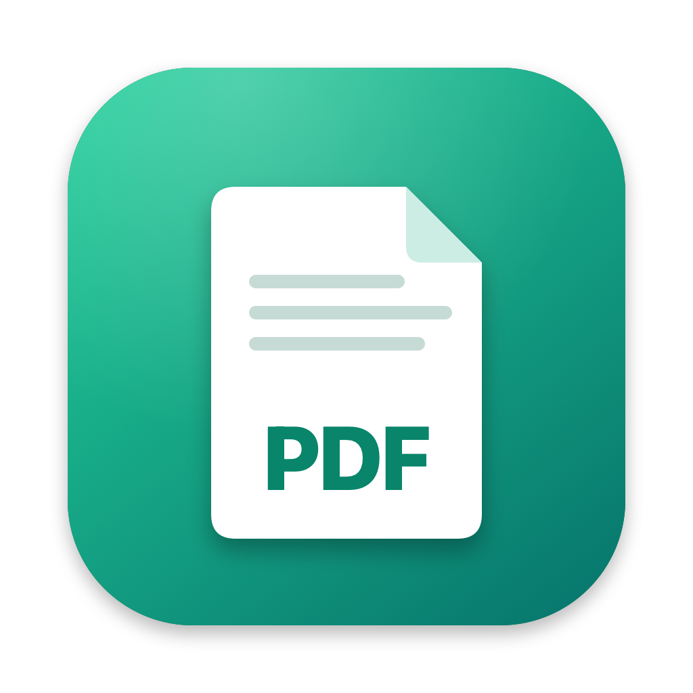
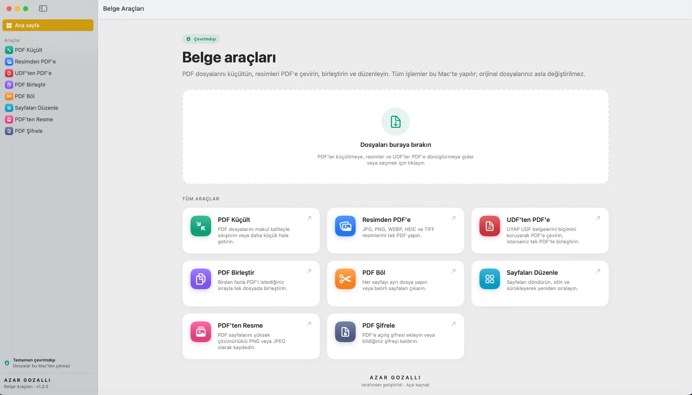
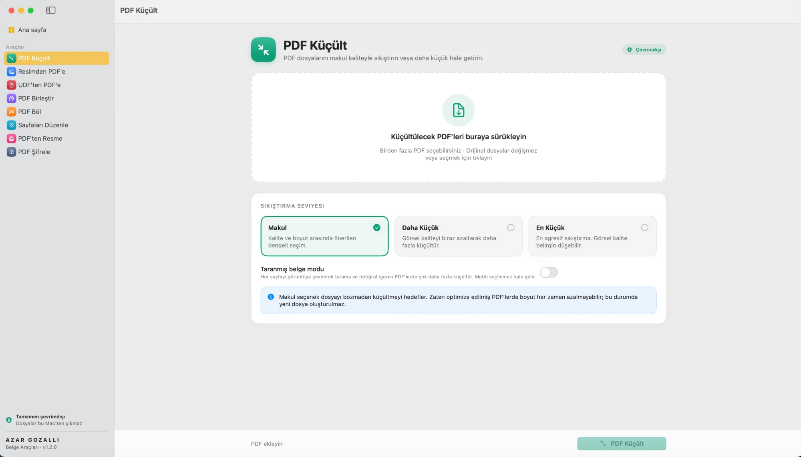
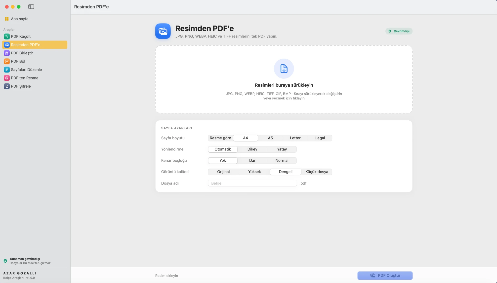
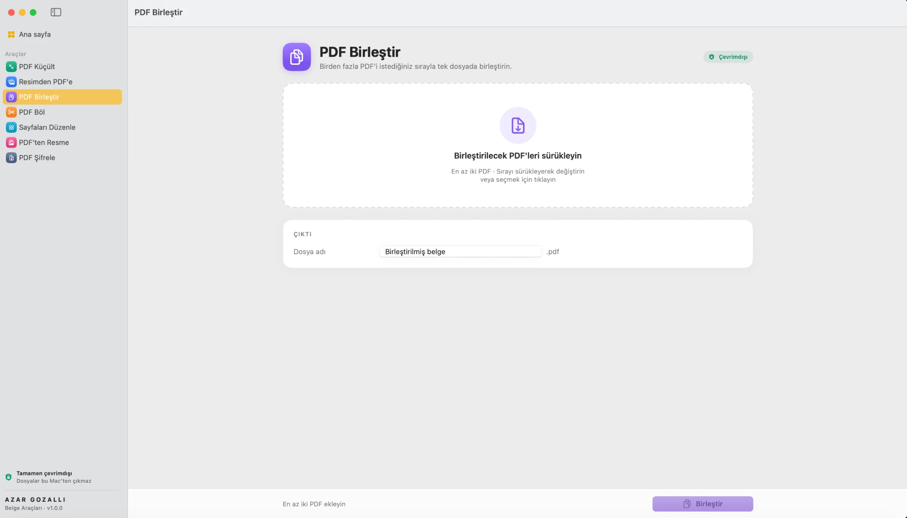
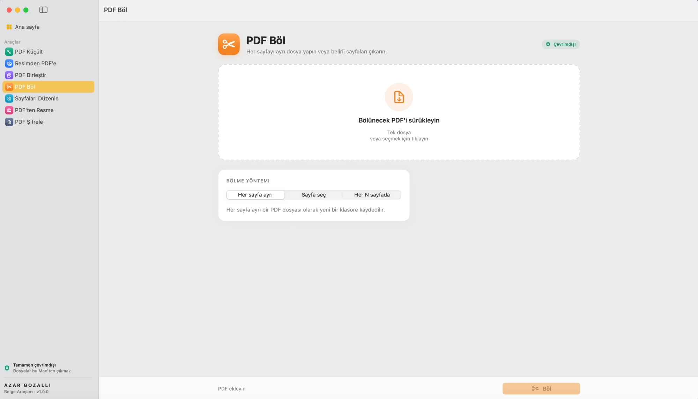
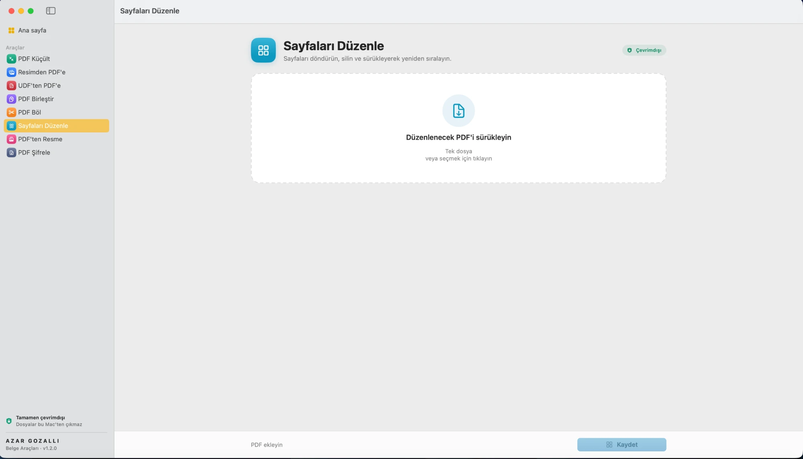
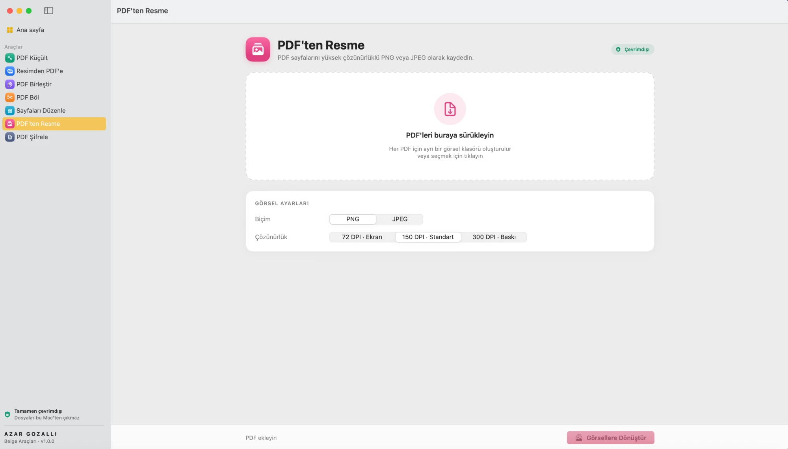
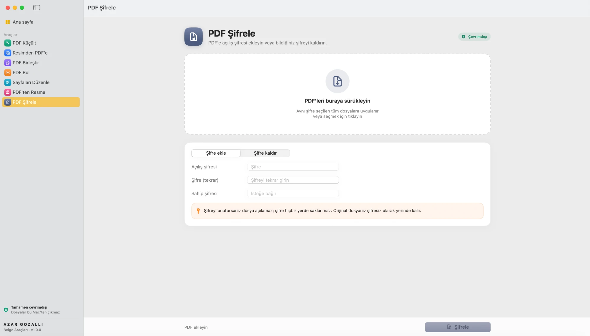

<p align="center">
  
</p>

<h1 align="center">Belge Araçları</h1>

<p align="center">
  macOS için tamamen <b>çevrimdışı</b> çalışan, hafif ve açık kaynak PDF araç kutusu.<br>
  Dosyalarınız hiçbir zaman bilgisayarınızdan çıkmaz.
</p>

<p align="center"><b>Geliştiren: AZAR GOZALLI</b></p>

<p align="center">
  
</p>

---

## Ekran görüntüleri

| PDF Küçült | Resimden PDF'e |
|---|---|
|  |  |
| **PDF Birleştir** | **PDF Böl** |
|  |  |
| **Sayfaları Düzenle** | **PDF'ten Resme** |
|  |  |
| **PDF Şifrele** | |
|  | |

## Özellikler

| Araç | Ne yapar |
|---|---|
| **PDF Küçült** | Makul / Daha Küçük / En Küçük seviyeleri. Metin seçilebilir kalır. Taranmış belgeler için ayrıca "taranmış belge modu". Birden fazla dosyayı tek seferde işler. |
| **Resimden PDF'e** | JPG, PNG, WEBP, HEIC, TIFF (çok sayfalı), GIF, BMP → tek PDF. Sayfa boyutu (A4, A5, Letter, Legal, resme göre), yönlendirme, kenar boşluğu ve kalite ayarı. Sürükleyerek sıralama. |
| **PDF Birleştir** | Birden fazla PDF'i istediğiniz sırayla tek dosyada birleştirir. |
| **PDF Böl** | Her sayfayı ayrı dosya yapar, `1-3, 5, 8-` gibi sayfaları çıkarır veya her N sayfada böler. |
| **Sayfaları Düzenle** | Sayfa küçük resimleri üzerinde döndürme, silme ve sürükleyerek sıralama. |
| **PDF'ten Resme** | Sayfaları 72 / 150 / 300 DPI PNG veya JPEG olarak kaydeder. |
| **PDF Şifrele** | Açılış şifresi ekler veya bildiğiniz şifreyi kaldırır. |

- Giriş ekranı veya hesap yoktur; uygulama açılınca doğrudan çalışır.
- **Ağ kodu yoktur.** Hiçbir veri internete gönderilmez veya internetten alınmaz.
- Orijinal dosyalar hiçbir zaman değiştirilmez veya üzerine yazılmaz. Yeni dosyalar orijinalin yanına (veya Ayarlar'da seçtiğiniz klasöre) kaydedilir.
- PDF küçültme, sonuç orijinalden büyük çıkarsa yeni dosya oluşturmaz.
- Finder'da PDF veya resimleri Dock simgesinin üzerine bırakabilir veya "Birlikte Aç" menüsünden kullanabilirsiniz.
- Açık ve koyu görünüm desteklenir. Apple Silicon ve Intel Mac'lerde çalışır (macOS 14 Sonoma ve üzeri).

### PDF küçültme nasıl çalışır?

Uygulama birkaç yerel yöntemi dener ve **en küçük geçerli sonucu** seçer:

1. **Yerleşik motor:** macOS Quartz filtresiyle görselleri yeniden sıkıştırır (Önizleme'deki "Dosya Boyutunu Küçült" mantığı, ayarlanabilir kalite ve DPI ile).
2. **PDFKit optimizasyonu**
3. **Ghostscript** *(isteğe bağlı):* Bilgisayarda kuruluysa (`brew install ghostscript`) bu motor da otomatik olarak denenir. Kurulu olması zorunlu değildir.

Her sonuç sayfa sayısıyla doğrulanır.

## Kurulum

1. [Releases](../../releases) sayfasından `Belge-Araclari-x.y.z.dmg` dosyasını indirin.
2. DMG'yi açıp **Belge Araçları** simgesini **Applications** klasörüne sürükleyin.
3. Uygulama Apple Developer hesabıyla imzalanmadığı için ilk açılışta macOS uyarı verebilir:
   - Uygulamaya sağ tıklayıp **Aç** seçeneğini seçin, **ya da**
   - **Sistem Ayarları → Gizlilik ve Güvenlik** bölümünden "Yine de Aç" butonuna basın, **ya da**
   - Terminal'de şu komutu çalıştırın: `xattr -cr "/Applications/Belge Araçları.app"`

## Kaynaktan derleme

Xcode Komut Satırı Araçları (Swift 5.10 veya üzeri) gerekir.

```bash
git clone https://github.com/avazargozalli/belge-araclari.git
cd belge-araclari
./Scripts/build.sh            # dist/ içine .app ve .dmg üretir
./Scripts/build.sh --install  # ayrıca /Applications klasörüne kurar
```

Geliştirme sırasında doğrudan çalıştırmak için: `swift run`

## Proje yapısı

```
Sources/BelgeAraclari/
  BelgeAraclariApp.swift     Uygulama, menüler, pencereler
  Engine/                    PDF işlemleri (UI'dan bağımsız)
    Compressor.swift         PDF küçültme
    ImageToPDF.swift         Resimden PDF
    PDFEngine.swift          Birleştir, böl, render, şifrele
    Support.swift            Dosya, çıktı ve görsel yardımcıları
  Models/                    Uygulama durumu ve araç modelleri
  Views/                     SwiftUI arayüzü
Scripts/
  build.sh                   .app + .dmg paketleme
  make_icon.swift            Uygulama ikonunu çizer
```

## Lisans

MIT © 2026 Azar Gozalli. Ayrıntılar için [LICENSE](LICENSE) dosyasına bakın.
