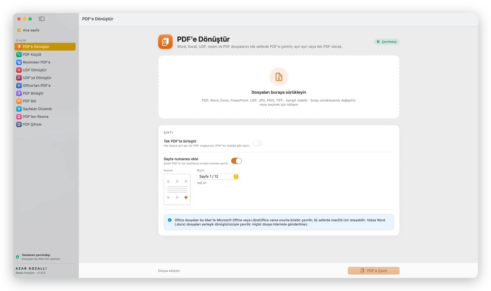
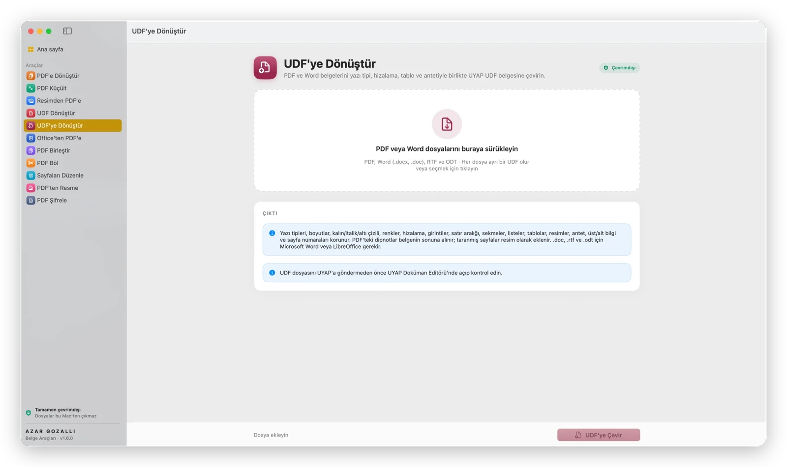
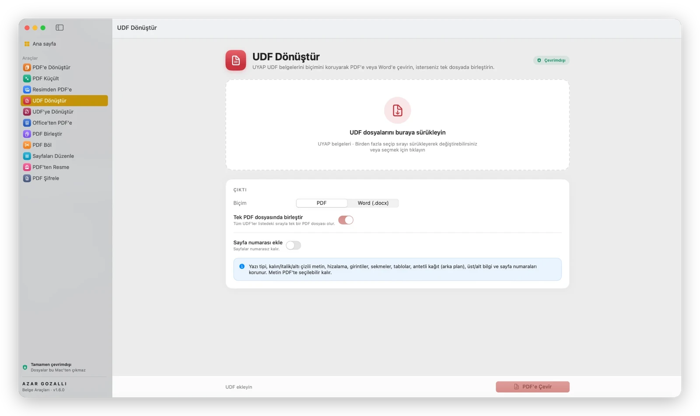
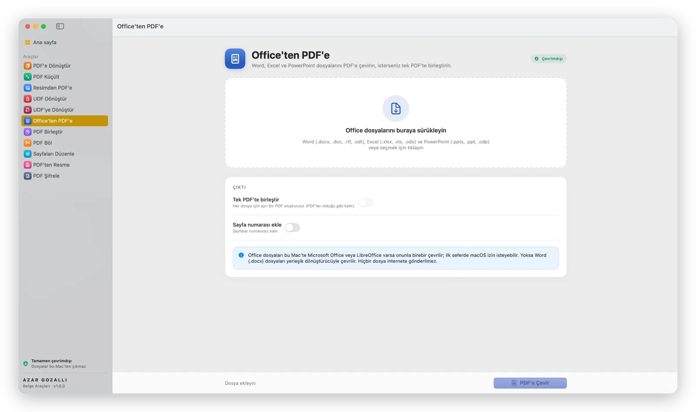

<p align="center">
  
</p>

<h1 align="center">Belge Araçları</h1>

<p align="center">
  <b>macOS</b> ve <b>Windows</b> için tamamen <b>çevrimdışı</b> çalışan, açık kaynak belge araç kutusu.<br>
  PDF, Word, Excel, PowerPoint, resim ve <b>UYAP UDF</b> belgelerini dönüştürün, birleştirin, küçültün ve düzenleyin.<br>
  Dosyalarınız hiçbir zaman bilgisayarınızdan çıkmaz.
</p>

<p align="center">
  <a href="../../releases/latest"><b>İndir: macOS (.dmg) · Windows (.exe)</b></a>
</p>

<p align="center"><b>Geliştiren: AZAR GOZALLI</b></p>

<p align="center">
  
</p>

---

## Öne çıkanlar

- **Her şeyi PDF'e:** Word, Excel, PowerPoint, UDF, resim ve PDF dosyalarını karışık olarak tek ekrana bırakın; ayrı ayrı PDF yapın veya listedeki sırayla tek PDF'te birleştirin.
- **UYAP UDF, iki yönde:** UDF'yi biçimini koruyarak PDF'e veya Word'e; PDF ve Word belgelerini yazı tipi, tablo ve antetiyle UDF'ye çevirin.
- **Sayfa numarası ekle:** PDF üreten her ekranda, konumu ve biçimi seçilebilir sayfa numarası.
- **Tamamen yerel:** Giriş ekranı, hesap veya ağ kodu yoktur. Hiçbir dosya internete gönderilmez; orijinal dosyalar hiçbir zaman değiştirilmez.

## Araçlar

### Dönüştürme

| Araç | Ne yapar |
|---|---|
| **PDF'e Dönüştür** | Word, Excel, PowerPoint, UDF, resim (JPG, PNG, TIFF…) ve PDF dosyalarını **karışık olarak** alır; her birini ayrı PDF yapar veya listedeki sırayla **tek PDF'te birleştirir**. Sıra sürükleyerek değiştirilir. |
| **Office'ten PDF'e** | Word (.docx, .doc, .rtf, .odt), Excel (.xlsx, .xls, .ods, .csv) ve PowerPoint (.pptx, .ppt, .odp) dosyalarını PDF'e çevirir, isterseniz birleştirir. |
| **Resimden PDF'e** | JPG, PNG, WEBP, HEIC, TIFF (çok sayfalı), GIF ve BMP dosyalarını tek PDF yapar. Sayfa boyutu (A4, A5, Letter, Legal, resme göre), yönlendirme, kenar boşluğu ve kalite ayarlanır. |
| **PDF'ten Resme** | Sayfaları 72 / 150 / 300 DPI PNG veya JPEG olarak kaydeder. |

### UYAP UDF

| Araç | Ne yapar |
|---|---|
| **UDF Dönüştür** | UYAP belgelerini (.udf) biçimini koruyarak **PDF'e** veya düzenlenebilir **Word'e (.docx)** çevirir. Birden fazla UDF sıralanıp tek dosyada birleştirilebilir. PDF'te metin seçilebilir kalır. |
| **UDF'ye Dönüştür** | **PDF** ve **Word** (.docx, .doc, .rtf, .odt) belgelerini UYAP UDF'ye çevirir. PDF'ler için "birebir görünüm" seçeneği her sayfayı resim olarak koyar. |

İki yönde de korunanlar: yazı tipleri ve boyutları, kalın/italik/altı ve üstü çizili metin, yazı ve zemin rengi, hizalama, girintiler (asılı girinti dahil), satır aralığı, paragraf boşlukları, sekmeler ve noktalı dolgular, numaralı ve madde işaretli listeler, tablolar (birleştirilmiş hücreler dahil), resimler, antetli kağıt, üst/alt bilgi ve sayfa numaraları.

### PDF işlemleri

| Araç | Ne yapar |
|---|---|
| **PDF Küçült** | Makul / Daha Küçük / En Küçük seviyeleri; metin seçilebilir kalır. Taranmış belgeler için ayrıca "taranmış belge modu". Birden fazla dosyayı tek seferde işler; sonuç orijinalden büyük çıkarsa yeni dosya oluşturmaz. |
| **PDF Birleştir** | Birden fazla PDF'i istediğiniz sırayla tek dosyada birleştirir. |
| **PDF Böl** | Her sayfayı ayrı dosya yapar, `1-3, 5, 8-` gibi sayfaları çıkarır veya her N sayfada böler. |
| **Sayfaları Düzenle** | Sayfa küçük resimleri üzerinde döndürme, silme ve sürükleyerek sıralama. |
| **PDF Şifrele** | AES-256 açılış şifresi ekler veya bildiğiniz şifreyi kaldırır. |

### Sayfa numarası ekle

PDF üreten her araçta (PDF'e Dönüştür, Office'ten PDF'e, Resimden PDF'e, UDF Dönüştür ve PDF Birleştir) çıkan PDF'in her sayfasına sırayla numara eklenebilir:

- **Konum:** sol, orta veya sağ; üstte veya altta. Küçük bir sayfa resmi üzerinde tek tıkla seçilir.
- **Biçim:** "1", "1 / 12", "Sayfa 1", "Sayfa 1 / 12" veya "- 1 -".
- Birleştirilen PDF'te numaralar baştan sona **kesintisiz** devam eder; döndürülmüş sayfalarda da seçilen köşeye düz yazılır.
- Numaranın arkasındaki küçük beyaz zemin sayesinde renkli antet bandının üstünde de okunur.
- Zaten PDF olan bir dosya numaralanırsa orijinali değişmez; "… - numaralı.pdf" adlı yeni bir kopya oluşur.

## Ekran görüntüleri

| PDF'e Dönüştür | UDF'ye Dönüştür |
|---|---|
|  |  |
| **UDF Dönüştür** | **Office'ten PDF'e** |
|  |  |
| **PDF Küçült** | **Resimden PDF'e** |
|  |  |
| **PDF Birleştir** | **PDF Böl** |
|  |  |
| **Sayfaları Düzenle** | **PDF'ten Resme** |
|  |  |
| **PDF Şifrele** | |
|  | |

## Genel özellikler

- Giriş ekranı veya hesap yoktur; uygulama açılınca doğrudan çalışır.
- **Ağ kodu yoktur.** Hiçbir veri internete gönderilmez veya internetten alınmaz.
- Orijinal dosyalar hiçbir zaman değiştirilmez veya üzerine yazılmaz. Yeni dosyalar orijinalin yanına (veya Ayarlar'da seçtiğiniz klasöre) kaydedilir.
- Dosyaları ana sayfaya bırakınca uygulama doğru araca yönlendirir: PDF'ler küçültmeye; Word, Excel, UDF ve resimler PDF'e dönüştürmeye gider. Karışık dosyalar "PDF'e Dönüştür"de açılır.
- macOS'ta dosyaları Dock simgesinin üzerine bırakabilir veya Finder'ın "Birlikte Aç" menüsünden kullanabilirsiniz.
- Açık ve koyu görünüm desteklenir. Apple Silicon ve Intel Mac'lerde çalışır (macOS 14 Sonoma ve üzeri).
- **Windows 10 ve 11** sürümünün arayüzü ve araçları aynıdır. Tek fark: Windows sürümü HEIC fotoğrafları okumaz; önce JPG olarak kaydedin.

## Nasıl çalışır?

### UDF → PDF ve Word

UDF, UYAP Doküman Editörü'nün biçimidir: tüm metni ve her metin parçasının yazı tipi, boyutu, hizalaması, girintileri ve sekme duraklarını tutan bir XML dosyası taşıyan bir ZIP arşivi. Uygulama bu bilgileri okuyup sayfayı UYAP'ın kurallarıyla yeniden dizer:

- **macOS:** Apple'ın metin motoru (TextKit) ile doğrudan PDF'e çizilir.
- **Windows:** Belge HTML'e çevrilip yerleşik Microsoft Edge WebView2 motoruyla PDF'e yazdırılır; antet, üst/alt bilgi ve sayfa numaraları her sayfanın altına ayrı bir katman olarak yerleştirilir.
- **Word:** Çıktı Microsoft Word, Pages ve LibreOffice'te açılan, düzenlenebilir bir `.docx` belgesidir. Antet her sayfada metnin arkasında durur; sayfa numaraları Word'ün canlı alanlarıdır (SAYFA / TOPLAM). Birleştirilen her UDF kendi sayfa düzeniyle ayrı bir Word bölümü olur. Liste numaraları UYAP'taki gibi metin olarak yazılır: Word'ün harfli numaralandırması İngiliz alfabesini (a, b, c, d), UYAP Türk alfabesini (a, b, c, ç) kullanır.

Satır kırılımları platformlar ve UYAP arasında yazı tipi ölçümü farkından dolayı birkaç kelime kayabilir; içerik ve biçim aynı kalır.

### PDF ve Word → UDF

Çıktı, UYAP Doküman Editörü'nün kurallarına göre yazılır: tek `content.xml`, `format_id="1.8"`, metnin tamamını boşluksuz kapsayan biçim aralıkları, `<page-break>` ile sayfa sonları, `mediaSizeName` ile kağıt boyutu ve UYAP'ın kendi numaralı/madde işaretli listeleri. Emoji gibi Editör'ün açamadığı karakterler değiştirilir ve her dosya bu kurallara göre denetlenir.

- **Word:** Belge Word'ün kurallarıyla (stiller, numaralandırma, sekmeler, tablolar, resimler, üst/alt bilgi, sayfa numarası, sayfa sonları) okunur. Paragraf içi satır sonları, UDF'de karşılığı olmadığı için ayrı paragraflara bölünür. Harfli listeler 4. maddeden sonra metin olarak yazılır (UYAP Türk alfabesiyle sayar). .doc, .rtf ve .odt önce kurulu Microsoft Word veya LibreOffice ile .docx'e çevrilir.
- **PDF:** Sayfanın çizim komutları okunur: her harfin konumu, yazı tipi, boyutu, rengi ve kalın/italikliği; altı çizgiler, vurgular, tablo çizgileri ve resimler. Bunlardan satırlar, paragraflar (hizalama, girinti, satır aralığı, paragraf boşluğu), sekmeler ve dolguları, listeler, çizgili ve yalnızca satır çizgili tablolar, her sayfada tekrarlanan üst/alt bilgi, sayfa numarası ve antet yeniden kurulur. Dipnotlar belgenin sonuna alınır; taranmış (metinsiz) sayfalar resim olarak eklenir. Döndürülmüş metin (ör. kenar boşluğundaki dikey sayfa numarası) aktarılmaz.

Dönüştürülen UDF'yi UYAP'a göndermeden önce UYAP Doküman Editörü'nde açıp kontrol edin.

### Office dosyaları

Office'in görünümünü birebir çizebilen, uygulamaya gömülebilecek kadar küçük bir motor yoktur. Bu yüzden iki yol birlikte kullanılır; ikisi de tamamen çevrimdışıdır:

- **Bilgisayarda Microsoft Office veya LibreOffice varsa** dosya onunla açılıp PDF'e aktarılır; sonuç Office'te yazdırdığınızla aynıdır. Excel, PowerPoint ve eski .doc/.xls/.ppt dosyaları bu yolla çevrilir. macOS'ta ilk seferde sistem, Belge Araçları'nın Word/Excel/PowerPoint'i kullanmasına izin vermenizi ister. Bu yol Ayarlar'dan kapatılabilir.
- **Hiçbiri yoksa** Word (.docx) dosyaları yerleşik dönüştürücüyle çevrilir: belge Word'ün kurallarıyla okunup UDF'teki gibi PDF'e dizilir. Dipnotlar belgenin sonuna taşınır; çok bölümlü belgelerde son bölümün sayfa düzeni kullanılır. Bilgisayarda olmayan Office yazı tipleri (ör. Calibri) benzer bir yazı tipiyle değiştirilir.

### PDF küçültme

Uygulama birkaç yerel yöntemi dener ve **en küçük geçerli sonucu** seçer:

1. **Yerleşik motor:** macOS Quartz filtresiyle görselleri yeniden sıkıştırır (Önizleme'deki "Dosya Boyutunu Küçült" mantığı, ayarlanabilir kalite ve DPI ile).
2. **PDFKit optimizasyonu**
3. **Ghostscript** *(isteğe bağlı):* Bilgisayarda kuruluysa (`brew install ghostscript`) bu motor da otomatik olarak denenir. Kurulu olması zorunlu değildir.

Her sonuç sayfa sayısıyla doğrulanır. Windows sürümünde yerleşik motor Rust ile yazılmıştır: PDF içindeki görselleri paralel olarak yeniden JPEG'e kodlar ve küçültür; metin ve vektör içerik olduğu gibi kalır. Ghostscript kuruluysa (`C:\Program Files\gs`) o da denenir.

### Teşekkür

UYAP Doküman Editörü'nün bazı öznitelikleri nasıl yorumladığına ve bir UDF'nin Editör'de açılabilmesi için gereken kurallara dair bilgiler (sayfa numarası bitleri, alt düzey liste biçimleri, harfli listelerin Türk alfabesiyle sayılması, tablo sütun oranları ve kenarlık türleri, sekme dolguları, sayfa sonları, kağıt boyutu kodları, BMP dışı karakterler, metin aralıklarının boşluksuz olması), Av. Arb. Mevlana İbrahim Asım Bilir'in [UDF Çevirici](https://github.com/miasimbilir/udf-cevirici) projesinin belgelerinden öğrenilmiştir. O projenin kodu kullanılmamıştır; uygulama bu bilgilerle bağımsız olarak yazılmıştır.

## Kurulum

### macOS

1. [Releases](../../releases/latest) sayfasından `Belge-Araclari-x.y.z.dmg` dosyasını indirin.
2. DMG'yi açıp **Belge Araçları** simgesini **Applications** klasörüne sürükleyin.
3. Uygulama Apple Developer hesabıyla imzalanmadığı için ilk açılışta macOS uyarı verebilir:
   - Uygulamaya sağ tıklayıp **Aç** seçeneğini seçin, **ya da**
   - **Sistem Ayarları → Gizlilik ve Güvenlik** bölümünden "Yine de Aç" butonuna basın, **ya da**
   - Terminal'de şu komutu çalıştırın: `xattr -cr "/Applications/Belge Araçları.app"`

### Windows

1. [Releases](../../releases/latest) sayfasından `Belge.Araclari_x.y.z_x64-setup.exe` dosyasını indirin.
2. Kurulum dosyasını çalıştırın. Yönetici izni gerekmez; uygulama yalnızca sizin kullanıcı hesabınıza kurulur.
3. Kurulum dosyası dijital olarak imzalanmadığı için Windows SmartScreen "Windows bilgisayarınızı korudu" uyarısı gösterebilir. **Ek bilgi → Yine de çalıştır** ile devam edin.

Uygulama arayüz için Windows'ta yerleşik olan Microsoft Edge WebView2'yi kullanır (Windows 11'de ve güncel Windows 10'da zaten kuruludur). Yalnızca eksikse kurulum sırasında Microsoft'tan indirilir; uygulamanın kendisi hiçbir zaman internete bağlanmaz.

## Kaynaktan derleme

### macOS

Xcode Komut Satırı Araçları (Swift 5.10 veya üzeri) ve Rust gerekir. Ortak çekirdek iki mimari için derlendiğinden bir kez `rustup target add aarch64-apple-darwin x86_64-apple-darwin` çalıştırın.

```bash
git clone https://github.com/avazargozalli/belge-araclari.git
cd belge-araclari
./Scripts/build.sh            # dist/ içine .app ve .dmg üretir
./Scripts/build.sh --install  # ayrıca /Applications klasörüne kurar
```

Geliştirme sırasında doğrudan çalıştırmak için: `swift run`

### Windows

Node.js 22+ ve Rust (stable) gerekir. Windows kurulum dosyası her `main` güncellemesinde GitHub Actions tarafından Windows üzerinde derlenir, test edilir, sessizce kurulur ve kurulu uygulamayla örnek belgeler PDF'e, Word'e ve UDF'ye çevrilerek denetlenir. Yeni bir Release yayımlandığında kurulum dosyası otomatik olarak o sürüme eklenir.

```bash
cd windows
npm ci
cargo test --manifest-path ../core/Cargo.toml       # ortak çekirdek: UDF, Word, PDF okuyucu, sayfa numarası
cargo test --manifest-path src-tauri/Cargo.toml     # PDF motoru testleri (her platformda çalışır)
npm run build                                       # Windows'ta: kurulum dosyası üretir
```

## Proje yapısı

```
Sources/BelgeAraclari/        macOS uygulaması (SwiftUI)
  BelgeAraclariApp.swift      Uygulama, menüler, pencereler
  Engine/                     İşlemler (arayüzden bağımsız)
    Compressor.swift          PDF küçültme
    ImageToPDF.swift          Resimden PDF
    PDFEngine.swift           Birleştir, böl, render, şifrele
    UDF.swift                 UDF okuma ve TextKit ile PDF'e dizme
    UDFWord.swift             UDF → Word
    UDFMaker.swift            PDF / Word → UDF
    DocumentConverter.swift   Karışık dosyaları ve Office belgelerini PDF'e çevirme
    PageNumbering.swift       Sayfa numarası ekleme
    BelgeCore.swift           Paketteki ortak çekirdeği (belge-core) çalıştırma
    Support.swift             Dosya, çıktı ve görsel yardımcıları
  Models/                     Uygulama durumu ve araç modelleri
  Views/                      Arayüz
core/                         Ortak Rust çekirdeği (macOS'ta belge-core aracı, Windows'ta kütüphane)
  src/udf.rs                  UDF okuyucu ve yazdırmaya hazır HTML
  src/udf/docx.rs             UDF → Word
  src/word.rs                 Yerleşik Word (.docx) okuyucu
  src/pdf/read.rs             PDF okuyucu: harfler, yazı tipleri, renkler, çizgiler, resimler
  src/pdf/mod.rs              Sayfa düzeni → UDF
  src/pdf/numbers.rs          Sayfa numarası ekleme
  src/udfout.rs               UYAP kurallarına uygun UDF yazıcısı ve denetleyicisi
  src/convert.rs              PDF / Word → UDF
  src/office.rs               Kurulu Microsoft Office / LibreOffice ile dönüştürme
windows/                      Windows sürümü (Tauri 2)
  src-tauri/src/lib.rs        Arayüz ile motor arasındaki komutlar
  src-tauri/src/engine/       PDF motoru (Rust, lopdf): küçült, resimden PDF, birleştir, böl, şifrele
  src-tauri/src/udf_print.rs  UDF'yi WebView2 ile PDF'e yazdırma
  src-tauri/src/convert.rs    Karışık dosyaları ve Office belgelerini PDF'e çevirme
  ui/                         Arayüz (HTML/CSS/JS); sayfa görüntüleme için yerel pdf.js
  tests/fixtures/             Örnek (gerçek veri içermeyen) UDF test dosyası
Scripts/
  build.sh                    .app + .dmg paketleme
  make_icon.swift             Uygulama ikonunu çizer
.github/workflows/windows.yml Windows derleme, test ve kurulum denetimi
```

## Lisans

MIT © 2026 Azar Gozalli. Ayrıntılar için [LICENSE](LICENSE) dosyasına bakın.
